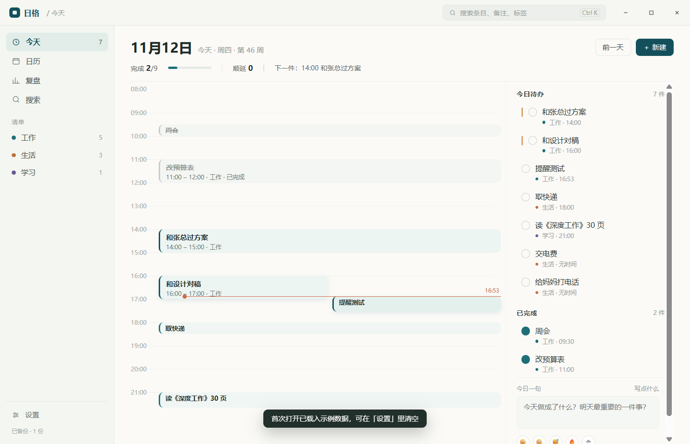

# 日格 · 个人日历清单工具

贴在 Windows 桌面上的日历纸：白天记日程和待办，晚上写一句复盘，手机随时能看、能勾、能记。



## 目录

| 目录 | 内容 |
| --- | --- |
| `windows/` | Windows 桌面端（Electron + SQLite），含源码、测试、打包产物 |
| `apps/mobile/` | 手机端页面（PWA，APK 内置的就是这一份） |
| `apps/android/` | Android 安装包与打包脚本 |
| `server/` | 云端同步服务（盲存储，只存密文） |
| `doc/` | 方案、原型、使用说明、同步指南、上下文存档 |

## 三块东西

- **桌面端**：桌面常驻日历组件、`Ctrl+Alt+Space` 速记、今天/日历/复盘/设置、到期提醒；
- **手机端**：APK，6 个页面，离线可用，和电脑双向同步；
- **同步**：自己的云服务器 + 端到端加密（PBKDF2 + AES-256-GCM），服务器看不到内容。

## 从零跑起来（新克隆的仓库）

仓库里不含 `windows/runtime`、`windows/dist`、`windows/node_modules`（体积原因）。

```powershell
cd windows
$env:ELECTRON_MIRROR='https://npmmirror.com/mirrors/electron/'
npm install          # electron 45.3.1 + sql.js + playwright-core
npm start            # 用 node_modules 里的 electron 启动
```

跑测试需要 `windows/runtime/electron.exe`（测试里写死了这个路径）。两种做法：

- 下载 `electron-v45.3.1-win32-x64.zip` 解压到 `windows/runtime/`；
- 或改 `windows/test/*.js` 里的 `ELECTRON` 指向 `node_modules\electron\dist\electron.exe`。

`windows/test/packaged.js` 只对已打包的 `dist\日格` 有效，新克隆没有 dist 可以跳过。

## 快速开始

```bash
# 桌面端
cd windows && npm start

# 测试（需要先清掉 ELECTRON_RUN_AS_NODE）
$env:ELECTRON_RUN_AS_NODE=$null
node test/e2e.js              # 桌面端 32 项
node test/cloud-sync-e2e.js   # 云同步 12 项
```


手机端安装与云服务器部署见 [doc/日格-手机同步-设置指南.md](doc/日格-手机同步-设置指南.md)。

## 文档

- [产品方案](doc/日格-个人日历清单工具-产品方案-v0.1.md)
- [使用说明](doc/日格-使用说明-v0.1.md)
- [手机同步与部署](doc/日格-手机同步-设置指南.md)
- [项目上下文存档](doc/项目上下文存档-2026-11-12.md)
